# GitHub Release deployment architecture

Status: implementation proposed for review; not qualified for live rollout. No EC2
access, service changes, real release publication, or successful image upload was
performed. The existing one-argument workflow remains available during migration.

`deploy-homolog.sh MODE VERSION` and `deploy-production.sh MODE VERSION` consume an
explicit immutable GitHub Release in `ghptc/ec2-workspace`. Deployment never
resolves a branch, compiles code, or reads `.state/approved`. An invalid two-argument
request cannot fall back to the legacy path.

```mermaid
flowchart LR
  P[Reviewed full dependency pins] --> G[Local isolated release gates]
  G --> I[Private GHCR image by OCI digest]
  I --> D[GitHub draft and verified manifest]
  D --> R[Protected tag and immutable RC release]
  R --> H[Explicit homolog deployment]
  H --> E[Successful GitHub homolog deployment evidence]
  E --> S[Stable release with identical image and provenance]
  S --> PROD[Explicit production deployment]
```



## Ownership and identity

| Repository | Responsibility |
| --- | --- |
| `cod4x-server` | Engine source, compilation and native/gameplay regressions; upstream tags/history remain intact. Companion PR [#17](https://github.com/ghptc/cod4x-server/pull/17) disables self-updates in the isolated harness. |
| `cod4-config-server` | Native shared and mode CFGs only. The workspace validates contracts, syntax, required values and conflicting overrides. No scripts or generated documentation are added there. |
| `ec2-workspace` | Dependency pins, integration and packaging, release manifest/publication, deployment, rollback and environment journals. |

`release/dependencies.json` pins complete engine/config/Bot Warfare SHAs, the
engine's asset-lock SHA-256, and builder/runtime-base image config digests. A pin
must be in the canonical repository's protected `master` history. The workspace
release checkout must be the exact protected tip, clean, complete, and free of
replace refs/grafts. The engine pin deliberately includes PR #17; publication
fails until that commit enters protected history. A squash merge requires a new
reviewed pin to the resulting commit.

As inspected on 2026-10-26, workspace and configuration have no tags; none of the
three repositories has a GitHub Release. Engine tags are inherited upstream
version identities and do not determine the workspace's application version.
The first workspace candidate is `v0.1.0-rc.1`. The version gate rechecks tags at
execution; this document does not reserve a version.

`release/version-baseline.json` preserves historical commit messages. New workspace
first-parent changes use Conventional Commits. Fix/perf increments patch, feat
increments minor, and breaking changes increment major, including before 1.0.
GitHub merge envelopes use the merged subject. Other historical/nonconventional
new subjects fail the gate. RC numbers increase monotonically for the computed
base version. Stable promotion must remove only the RC suffix of its source.

The manifest binds the workspace/source/dependency SHAs, original authorized asset
hashes, binary and transformed fastfile hashes, every packaged regular file hash,
all required external game-data file hashes, startup requirements, platform,
config-content hash, OCI distribution digest, Docker image config digest, gate
results and private test-evidence hashes. Config hashes identify the original
three canonical CFGs. `files` additionally binds the generated runtime CFGs,
including the release-only `bot_enable=1` and mode-capacity `bot_fill_limit` policy.
The image labels bind sources/mode/config/workspace identity.

The distribution digest (`ghcr.io/ghptc/cod4-runtime@sha256:...`) and image config
ID are distinct. They are checked separately. A pull by distribution digest must
resolve to the locally tested config ID. EC2 receives a Docker archive of that
verified ID through the existing SSH transfer; it needs no registry credential.

## Release gates and writer boundary

`.github/workflows/release.yml` runs only on manual dispatch from `master`, in the
`release-publication` GitHub environment, with repository-wide concurrency and
`cancel-in-progress: false`. It has no EC2 credentials or deployment steps. The
runner label `cod4-release-isolated` must identify a dedicated local release
runner, never a runtime/EC2 host. There is no PR, push, or merge publication trigger.

Before enabling dispatch, an administrator must separately configure:

1. Immutable releases on the workspace repository. It is currently **disabled**.
2. An active tag ruleset covering `refs/tags/v*`, without exclusions, restricting
   creation, update and deletion. Currently only a branch ruleset exists. Permit
   only the designated release writer to bypass creation; do not grant routine
   users update/deletion bypass. Existing tags/releases are never overwritten.
3. `release-publication` environment: required owner reviewers, protected-master
   restriction and prevention of self-approval where supported. Store a narrowly
   scoped `RELEASE_TOKEN` with contents/package read/write permissions and tag-rule
   creation authorization. Keep it exclusive to this workflow/environment.
4. A pre-provisioned **private** `ghcr.io/ghptc/cod4-runtime` package and a private
   Docker credential helper on the runner. Read its visibility before every
   upload. Missing/public package blocks publication. Never upload proprietary
   Promod/game assets to a public package, release asset, CI log or cache.
5. Explicit authorized `COD4_PROMOD_ASSETS`, `COD4_INTEGRITY_HEADERS`, `COD4_OAT`,
   `COD4_GAME_DATA` environment variables; Python 3.11+, GCC, Bash, Git, Docker,
   Trivy, GNU coreutils/flock and GitHub CLI with release-attestation verification.
   Protect scanner/toolchain installation; tool/image identities and scanner
   report hashes are retained in provenance. Game data stays outside the image.

`release-build.sh` acquires a local lock in addition to workflow concurrency. It:

1. Checks repository policy, duplicate tags/drafts and calculated version.
2. Fetches exact full source pins into fresh detached checkouts; checks canonical
   protected ancestry, Git integrity, cleanliness, bot pin and asset-lock hash.
   Rejects unrelated tracked configuration-repository files.
3. Verifies supplied Promod/header hashes and official OAT binary hashes before
   compilation, then validates the complete mode catalog.
4. Compiles and runs engine integrity/native policy checks in the pinned builder.
   Sets `SOURCE_DATE_EPOCH` from the engine commit. A second clean compilation in
   the same `/src` toolchain must produce a byte-identical engine binary. Normalize
   artifact filesystem/image timestamps and rebuild the Docker image without layer
   cache; its config/content ID must also match before proceeding.
5. Runs engine/workspace unit tests and all existing local runtime scenarios:
   controls, gameplay, admission policy, rotation, burst, legacy admission,
   missing waypoints and all-map empty rotation. Each engine runner verifies its
   evidence and fails on unsuccessful assertions.
6. Exercises the actual packaged image with read-only root, no network/ports,
   dropped capabilities and read-only game data. Checks effective mode, purity,
   disabled updater, bot enable/fill limit/readiness/population, and eight headers.
7. Runs Trivy with a nonzero exit for HIGH/CRITICAL findings; errors also block.
   Missing tools, game data, native libraries or evidence cannot be skipped.
8. Builds a complete provisional manifest and validates every local field before
   registry mutation. Pushes a unique staging image only after local gates pass,
   checks registry round-trip identity, then finalizes its distribution digest.
9. Rechecks publication policy/version/history, creates a draft, uploads its
   manifest and verifies the server asset digest. Only then creates the protected
   tag with an atomic create-ref operation, publishes the immutable release, and
   verifies its signed release and asset attestations.

GitHub does not provide one transaction spanning a registry, Git ref and release.
An interruption can leave an unreferenced private image, a reserved tag or a draft;
none is deployable. Consumers require a complete published immutable release,
valid attestation/manifest and exact tag commit. The singleton writer plus atomic
ref creation prevents concurrent jobs from replacing another publication. See the
recovery procedure; never delete abandoned evidence or move/reuse a version.

## Deployment and promotion

```bash
./scripts/deploy-homolog.sh promod v0.1.0-rc.1
# After successful homolog qualification, manually dispatch operation=promote,
# version=v0.1.0, candidate=v0.1.0-rc.1, homolog_deployment_id=<successful ID>.
./scripts/deploy-production.sh promod v0.1.0
```

Deployment credentials are environment-specific local secrets:
`COD4_HOMOLOG_RCON_PASSWORD` and `COD4_PRODUCTION_RCON_PASSWORD`. Production needs
both. Existing private server CFGs/passwords are retained. Passwords travel only
through encrypted SSH stdin, never argv, release manifests or local evidence.
GitHub authentication needs release/package read and deployments write access;
the deployment host has no GitHub/registry writer credential requirement.

Release resolution verifies immutable state, exact prerelease flag, the signed
release/asset attestation, full tag SHA and requested mode. Production rejects RCs
before network access. A stable manifest must match its RC's entire artifact
payload and point to the same candidate version family. Its recorded homolog
GitHub deployment must have matching commit, mode, manifest hash and both image
digests, with latest status `success`. Release notes and mutable prerelease flags
cannot substitute for the signed manifest policy.

Promotion copies the candidate payload and OCI reference; it has no build or
image-push step. A new stable tag points to the candidate workspace commit, which
must remain in protected history. Deployment additionally requires homolog still
running that image with verified startup provenance and current effective health.
Homolog may subsequently deploy another candidate without changing production's
history; rollback to a previous stable still follows this live-homolog policy.

Before runtime mutation, the existing adapter validates source labels, platform,
mode, supported argv, capacity, mounts, private-home path, artifact shadowing and
purity. Release deployment also requires existing non-root, read-only, nonprivileged
isolation, and read-only canonical `main`/`zone` binds under `/opt/services/cod4`.
Their exact file inventory/checksums must match the manifest. Drift, added files,
symlinks or unsupported layouts require review, never automatic repair.

Only the selected Compose service is recreated with `--no-deps --pull never`.
Secrets, ports, volumes, user and other settings are retained. Production retains
interactive confirmation. Health checks use homolog UDP 28962 or production UDP
28960, plus authenticated read-only cvar and native bot-status queries. Human
occupancy is allowed within capacity. No release deployment writes an approval.

Private `.state/deployments/ENV/transaction.*/` retains the verified manifest,
baseline/candidate configurations, append-only fsynced UTC events and GitHub
deployment response. Sensitive configuration stays mode 0600 under private dirs.
Success records version, OCI/config digests and timestamp. GitHub Deployments
records each successful environment independently with `auto_inactive: false`.
Rollback events include the restored image ID and prior release version where
known; legacy baselines honestly have an unknown version.

`INT`, `TERM` and `HUP` during rollout attempt restoration of the exact saved
baseline and verify its image/UDP health. SIGKILL, SSH loss and failed rollback
leave durable unresolved intent, which blocks another release rollout. A healthy
runtime whose GitHub evidence write failed is retained for reconciliation; it is
never silently counted as promoted. Existing operations continue to assume one
controlled operations checkout; its deployment/lifecycle lock does not coordinate
arbitrary manual Docker changes or independent operator clones.

## Qualification boundaries

Local mocked policy/operations checks do not establish real authentication,
graphical FPS, gameplay, anticheat suitability or production readiness. Existing
README qualification limits still apply. This change did not run the full licensed
asset build/runtime/CVE gates or publish a test release. The pinned old base may
fail the security gate; remediation requires a separately reviewed new base pin.

Engine binary and uncached Docker image reproducibility are executable gates.
They have not been demonstrated with the licensed inputs in this task; a mismatch
blocks publication and requires Docker/toolchain/exporter qualification on the
dedicated runner. The published artifact is always reused
by digest for promotion/deployment, including when reconstruction tools change.
Retain the private registry blob and private gate evidence; provenance is not a
substitute for artifact retention. Configuration and registry/repository settings
remain administrator-managed prerequisites and were not changed by this PR.

References: [GitHub immutable releases](https://docs.github.com/en/code-security/concepts/supply-chain-security/immutable-releases),
[release integrity verification](https://docs.github.com/en/code-security/how-tos/secure-your-supply-chain/secure-your-dependencies/verify-release-integrity),
[CLI asset verification](https://cli.github.com/manual/gh_release_verify-asset).
